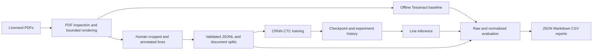

# Architecture

The package deliberately uses a few complete modules instead of many empty directories.
`documents` bounds decoded pixel count and renders sequentially with explicit PDFium
resource release. `datasets` validates provenance fields and enforces sample/document
integrity. `engines` invokes Tesseract without a shell. `model` provides convolutional
features, packed bidirectional sequence modeling and greedy CTC. `training` owns
optional torch dependencies and checkpoint state; ordinary OCR commands need no torch.
`evaluation` accepts the same engine protocol for Tesseract or CRNN. `reporting` compares
local experiments. `common` records runtime identity, normalization and device metadata.
`config` validates training settings without importing torch. `cli` exposes all operations with meaningful nonzero exits.

Images are resized to fixed height, retaining width; oversized lines are rejected.
Right padding is white (normalized +1). Time length is floor(width/4), reflecting two
2x2 pooling layers; packed LSTM prevents recurrent use of padded time steps. CNNs can
still see border padding near line ends. Targets use blank ID zero exclusively for
CTC; Unicode code points map to positive IDs. Repeated adjacent targets require extra
time steps and are checked before loss. Float32 CTC runs outside AMP. Training is
line recognition only; document segmentation is a separate future component.
